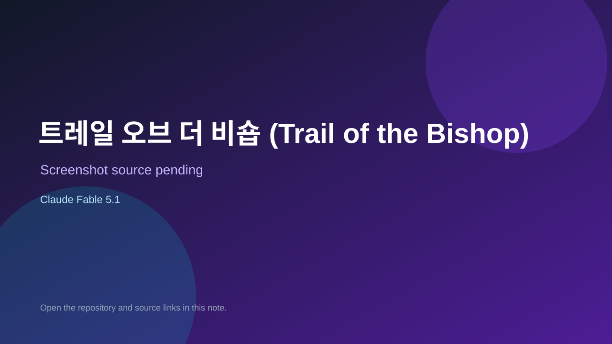

# 트레일 오브 더 비숍 (Trail of the Bishop)

> Verified game note.

## At a glance

- **Score:** 7.1/10
- **Model:** Claude Fable 5.1
- **Technology:** JavaScript, Browser
- **Estimated FP32 operations/s at 60 FPS:** 10,000,000 (low confidence; static estimate, not measured).
- **Rating basis:** Heuristic from source size, README and commit history (5.8 + 0.6*log10(code KB+1), +0.3 with a reachable demo); no runtime playtest.
- **Verified:** 2026-10-26
- **Repository:** [https://github.com/BumjinGwak/trail-of-the-bishop](https://github.com/BumjinGwak/trail-of-the-bishop)
- **Evidence:** [direct model evidence](https://github.com/BumjinGwak/trail-of-the-bishop/commit/8dd511a9c7c788370f9c309138674648b95b4b02)
- **Live demo:** [open demo](https://bumjingwak.github.io/trail-of-the-bishop/)

## Screenshots

No screenshot source is recorded yet. Keep the placeholder until a repository, awesome list, or creator source provides an image.

## Model attribution

Open the evidence link above. Evidence grade: **direct model evidence**.

## Source description

검은 비숍이 그림자로 만들어진 검은 칸만 밟아 왕관까지 가는 아이소메트릭 퍼즐. (옛 이름: 그늘길). Commit carries an exact Claude Fable 5.1 co-author trailer. Live demo returned HTTP 200 (availability only, not a playtest). Source inspected from README, file tree and commit history only; no playtest.

### Gameplay source

- [https://github.com/BumjinGwak/trail-of-the-bishop/blob/main/game.js](https://github.com/BumjinGwak/trail-of-the-bishop/blob/main/game.js)
- [https://github.com/BumjinGwak/trail-of-the-bishop/commit/8dd511a9c7c788370f9c309138674648b95b4b02](https://github.com/BumjinGwak/trail-of-the-bishop/commit/8dd511a9c7c788370f9c309138674648b95b4b02)

## Verification notes

- **Status:** verified_source
- **Counted units in repository:** 1
- **Units covered by this note:** 1
- **Discovery:** GitHub commit pool: model+game commits 2026-10-24T01:00Z..2026-10-26T01:00Z (30-minute Opus 5.5 partitions from 2026-10-24T20:00Z and wider other-model UTC partitions; covers windows left unsearched on 2026-10-25) joined to repositories created after 2026-10-23T01:00Z; https://github.com/BumjinGwak/trail-of-the-bishop

[Back to the awesome list](../../README.md)
