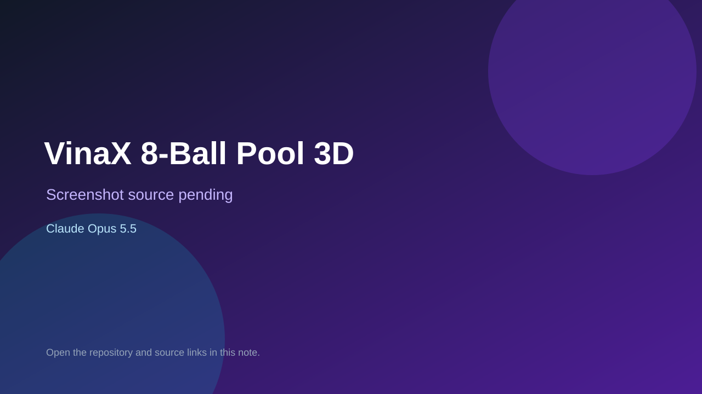

# VinaX 8-Ball Pool 3D

> Verified game note.

## At a glance

- **Score:** 6.9/10
- **Model:** Claude Opus 5.5
- **Technology:** JavaScript, Three.js, Browser
- **Estimated FP32 operations/s at 60 FPS:** 1,000,000,000 (low confidence; static estimate, not measured).
- **Rating basis:** Heuristic from source size, README and commit history (5.8 + 0.6*log10(code KB+1), +0.3 with a reachable demo); no runtime playtest.
- **Verified:** 2026-10-27
- **Repository:** [https://github.com/Vinay1812007/VinaX-Multiplayer-games](https://github.com/Vinay1812007/VinaX-Multiplayer-games)
- **Evidence:** [direct model evidence](https://github.com/Vinay1812007/VinaX-Multiplayer-games/commit/3aa31f9afa623a1b150687648340d144b543e757)

## Screenshots

No screenshot source is recorded yet. Keep the placeholder until a repository, awesome list, or creator source provides an image.

## Model attribution

Open the evidence link above. Evidence grade: **direct model evidence**.

## Source description

Real-time multiplayer 8-Ball Pool in 3D, playable in any modern browser on desktop or phone. Built with Node.js, Socket.IO and Three.js, and ready to deploy on Render's free tier, with a keep-alive system so the server never sleeps. Commit carries an exact Claude Opus 5.5 co-author trailer. Source inspected from README, file tree and commit history only; no playtest.

### Gameplay source

- [https://github.com/Vinay1812007/VinaX-Multiplayer-games/blob/main/public/js/pool3d.js](https://github.com/Vinay1812007/VinaX-Multiplayer-games/blob/main/public/js/pool3d.js)
- [https://github.com/Vinay1812007/VinaX-Multiplayer-games/commit/3aa31f9afa623a1b150687648340d144b543e757](https://github.com/Vinay1812007/VinaX-Multiplayer-games/commit/3aa31f9afa623a1b150687648340d144b543e757)

## Verification notes

- **Status:** verified_source
- **Counted units in repository:** 1
- **Units covered by this note:** 1
- **Discovery:** GitHub commit pool: model+game commits 2026-10-26T07:00Z..2026-10-27T01:00Z (30-minute Opus 5.5 and 2-6 hour other-model UTC partitions, via gh-read) joined to repositories created after 2026-10-25T01:00Z; https://github.com/Vinay1812007/VinaX-Multiplayer-games

[Back to the awesome list](../../README.md)
